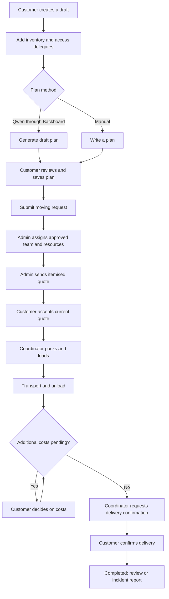
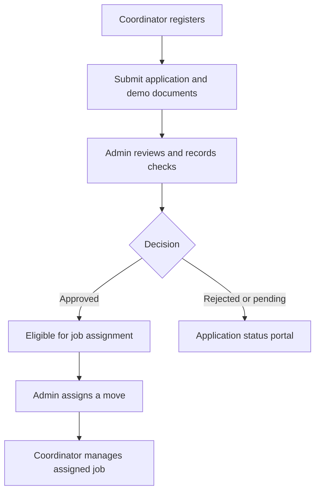

# MoveMate 🚚

### Helping a friend move without putting work on hold

MoveMate is a moving coordination prototype connecting customers with coordinators, vehicles and workers. Qwen, accessed through **Backboard.io**, generates editable moving plans. Dedicated customer, coordinator and admin portals manage the booking journey.

Built for the **Hacktoberfest Weekend Challenge: Build for a Friend**.

## The story

A friend in Pune was moving between flats while a critical deployment was happening at work. He needed to attend meetings and support his team while arranging workers, packing and transportation. MoveMate was inspired by this conflict: help people organise moving tasks around their work commitments, with a coordinator and progress updates in one place. The application supports moving requests across cities, rather than being limited to Pune.

## Live links

| Service | Link |
| --- | --- |
| Frontend | [Open MoveMate](https://frontend-silk-three-78.vercel.app) |
| Backend | [API base URL](https://movemate-backend-6cb8.onrender.com/api) |
| Health check | [Backend health](https://movemate-backend-6cb8.onrender.com/api/health) |

The backend root URL may return `Endpoint not found`; use the API routes above. This prototype does not arrange real moving services.

## Admin demo access

Sign in through the frontend's regular login page. The server determines your role and opens the corresponding dashboard.

| Field | Demo value |
| --- | --- |
| Email | `anushkasharma110720@gmail.com` |
| Password | `anushkasharma110720` |

**Before publishing:** replace these placeholders only with credentials for a dedicated demo account on a demo database. Keep production admin credentials private. Admin access permits operational changes and access to uploaded identity documents, so use fictional data and demo documents in the public environment.

Customers and coordinators can register through the application. Coordinators must complete their application and receive admin approval before accessing assigned jobs.

## Features

### Customer

- Register, sign in and manage a profile.
- Enter pickup/delivery details, inventory and unavailable hours.
- Nominate authorised access delegates.
- Generate and review a Qwen moving plan, or save a manual plan.
- Submit a request, review an itemised quote and accept it.
- Follow job progress, exchange messages and decide on extra costs.
- Confirm delivery, leave a review and report incidents.

### Coordinator

- Submit a work profile, demo identity document and reference consent.
- View application status and assigned jobs after approval.
- Follow task checklists and record moving stages.
- Upload evidence, exchange messages and request additional costs.

### Admin

- Review coordinator applications and record verification checks.
- Manage vehicles and workers.
- Assign coordinators, vehicles and crew with reservation conflict checks.
- Issue itemised quotes and manage operational requests and incidents.
- Access customer and coordinator operational portals.

## Booking flowchart



### Coordinator approval flow



## Technology

| Layer | Technology |
| --- | --- |
| Frontend | React, Vite, React Router |
| Backend | Node.js, Express |
| Database | MongoDB Atlas / MongoDB replica set |
| AI model | Qwen3-30B-A3B-Instruct-2507 |
| Hosted AI integration | Backboard.io, configured with OpenRouter model routing |
| Authentication | JWT, server-side role and ownership checks |
| Deployment | Vercel frontend, Render backend |

## AI integration and open innovation

The backend's `POST /api/moves/:id/ai-plan` endpoint sends relevant inventory and moving constraints to hosted Qwen through Backboard. The response is validated and presented as an editable draft. The customer reviews and saves the plan before submission.

Qwen is an open-weight model. The configurable model setting enables experimentation; self-hosting and fine-tuning are possible future directions, not implemented features. The current integration uses hosted inference and requires internet access and provider credits.

AI cannot assign providers, confirm availability, set prices, approve charges or determine liability. If AI is unavailable, customers can save a manual plan; the backend does not fabricate an AI response.

## Access control

- Customers access their own moves and customer operations.
- Coordinators access their application and, after approval, assigned jobs.
- Admins access operational customer/coordinator APIs and admin APIs.
- The backend checks role, approval and ownership independently of frontend routing.
- Login uses the server's role; a client-side role selector cannot grant privileges.
- Sessions expire after eight hours. Logout revokes server tokens.

## Local setup

### Requirements

- Node.js 22 or newer.
- MongoDB Atlas or a local MongoDB replica set. Transactions require a replica set; standalone MongoDB is insufficient.

### Backend — PowerShell

```powershell
cd backend
npm install
Copy-Item .env.example .env
```

Configure the values in `backend/.env`, including:

```dotenv
MONGODB_URI=YOUR_MONGODB_CONNECTION_STRING
JWT_SECRET=YOUR_RANDOM_SECRET
CLIENT_ORIGIN=http://localhost:5173
ADMIN_EMAIL=YOUR_PRIVATE_ADMIN_EMAIL
ADMIN_PASSWORD=YOUR_PRIVATE_ADMIN_PASSWORD
BACKBOARD_API_KEY=YOUR_BACKBOARD_KEY
BACKBOARD_MODEL=qwen/qwen3-30b-a3b-instruct-2507
```

Use a random JWT secret of at least 32 characters and an admin password of at least 12 characters. Never commit `.env`.

```powershell
npm run seed
npm run dev
```

Seeding creates the first admin only if its email does not already exist; it does not overwrite an existing account.

### Frontend — separate PowerShell terminal

```powershell
cd frontend
npm install
Copy-Item .env.example .env
```

Set:

```dotenv
VITE_API_URL=http://localhost:5000/api
```

```powershell
npm run dev
```

Open `http://localhost:5173`. Restart Vite after changing environment variables.

## Deployment configuration

### Render backend

- Root directory: `backend`
- Build command: `npm ci --omit=dev`
- Start command: `npm start`
- Health path: `/api/health`
- Set backend environment variables on Render.
- Set `CLIENT_ORIGIN=https://frontend-silk-three-78.vercel.app` exactly, without a trailing slash.
- For reset emails, configure SMTP and `RESET_URL=https://frontend-silk-three-78.vercel.app/reset-password`.
- Store uploads on a persistent disk or private object storage; ephemeral storage loses files on restart/redeploy.

### Vercel frontend

- Root directory: `frontend`
- Build command: `npm run build`
- Output directory: `dist`
- Set `VITE_API_URL=https://movemate-backend-6cb8.onrender.com/api` before building.
- Configure SPA rewrites in `frontend/vercel.json` so dashboard routes work on refresh.

MongoDB, SMTP and Backboard credentials belong only on the backend. Redeploy the relevant service after changing its environment variables.

## Checks

```powershell
# Backend
cd backend
npm test

# Frontend — separate terminal
cd frontend
npm run build
npm run lint:integrated
npx playwright install chromium
npm run test:e2e
```

Backend tests use an isolated MongoDB replica set. AI tests use mocked provider responses; they do not establish live Qwen availability. E2E uses its own temporary servers; stop the development frontend before running it.

## Prototype limitations

- No SMS OTP, payment gateway, insurance, automated background checking or continuous GPS.
- Notifications are in-app, rather than browser push.
- Password reset requires SMTP configuration.
- Identity files are private authenticated uploads, not an encrypted identity vault. Use demo documents until production storage and verification processes are addressed.
- Roles are fixed; there is no editable permissions engine.

## Documentation

- [Backend setup](backend/README.md)
- [API reference](backend/API.md)
- [Frontend integration](backend/FRONTEND_INTEGRATION.md)
- [Postman collection](backend/MoveMate.postman_collection.json)

## Author

Built by **Anushka Sharma** for the Hacktoberfest Weekend Challenge: Build for a Friend.
